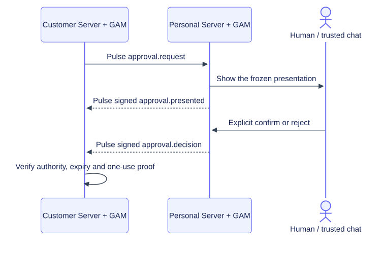

# Spectre Pulse

Pulse is a transport-independent protocol for communicating agents: canonical
addresses, versioned envelopes, discovery, transports, authenticated ingress and
technical delivery receipts. Native protocol and transport APIs remain useful
without an AgentServer. Phoenix WebSocket, REST, PubSub and distributed Erlang
adapters share these message semantics.

With Spectre 0.4, a Stack supplies the `pulse` helper, an Agent supplies routes,
and the AgentServer owns the conversation. Protocol/contact inspection is a
cognitive command; an explicitly bound send becomes a GAM proposal. Existing
Instance and Studio integrations remain available as separate runtime surfaces.

## Installation

Add the packages to your application:

```elixir
defp deps do
  [
    {:spectre, "~> 0.4.0"},
    {:spectre_pulse, "~> 0.1.0"}
  ]
end
```

For local development and explicit source overrides, see
[Contributing](#contributing).

## Discover the protocol in AgentServer

```elixir
defmodule MyApp.AI do
  use Spectre.Stack
  install Spectre.Pulse
end

defmodule MyApp.SupportServer do
  use Spectre.Server, tools: MyApp.AI

  def handle_flow({:support, :protocol}, _input, ctx),
    do: pulse(ctx, {:protocol}, on_result: :protocol)

  def handle_result(:protocol, {:ok, protocol}, ctx),
    do: respond(ctx, "#{protocol.name} version #{protocol.version}")

  def handle_result(tag, result, ctx), do: super(tag, result, ctx)
end

defmodule MyApp.SupportAgent do
  use Spectre.Agent, stack: MyApp.AI, server: MyApp.SupportServer
  flow :support do
    on :protocol, regex: ~r/^protocol$/i
  end
end
```

Start it with `Spectre.Server.start_link(agent: MyApp.SupportAgent, consumer:
self())` and submit `Spectre.Server.input(server, "protocol")`. The helper returns
through `handle_result/3`; it is generated from the Stack, not imported from Pulse.

## Send an agent message

Add `bind: [send: :notify_agent]` to the installation and enable `:notify_agent`
in the root Server's `gam:` operations. Spectre owns the automatic GAM connection
and registered execution. Then stage the message from a Server callback:

```elixir
pulse(ctx,
  {:send, %{to: "spectre://research/reviewer", act: :inform,
            payload: %{type: "research.completed", data: %{report_id: "r-42"}}}},
  on_result: :notified)
```

Payload types use protocol names such as `research.completed`, not MIME types
such as `text/plain`. Pulse pins the sender from the Agent configuration and the
message id from the admitted command. The host owns network/discovery configuration,
recipient authorization, consent when required, and reconciliation of uncertain sends.
A technical `:accepted` receipt does not prove that the remote task completed.

For authenticated inbound messages, the transport host selects the existing
Server and calls `Spectre.Pulse.receive(envelope, trusted_context,
agent_server: server)`. Acceptance returns `result.interaction`; replies arrive
asynchronously through the Server consumer. Do not derive authenticated identity
from an unverified `envelope.from`. The [integration guide](docs/SPECTRE_0_4.md)
spells out this boundary and the retained legacy paths.

## Ask a human through their personal agent

For example, a customer agent can require your consent before opening a browser.
Pulse delivers the frozen request to your personal AgentServer; its authenticated
chat consumer shows it to you. Managed GAM verifies your signed choice under the
customer's original permissions before deciding whether execution can proceed.



[Diagram source](docs/assets/readme-architecture.mmd).

In the personal Server's configured consumer, acknowledge rendering and submit
only the human's explicit choice for that exact request:

```elixir
reference = %{id: request["id"], from: request["from"]}
:ok = Spectre.Server.approval_presented(personal_server, reference)
# After the human chooses Approve; use :reject for refusal.
:ok = Spectre.Server.approval_decide(personal_server, reference, :confirm)
```

Select `{Spectre.Pulse.Approval, []}` as `gam.approvals.transport` on both Servers.
The [two-agent approval recipe](docs/EXTERNAL_APPROVALS.md) covers identities,
keys, local subscriptions and authenticated remote delivery. The AI never obtains
the human signing authority, and Pulse `accepted` receipts never count as consent.

## Documentation

- [External human approvals between AgentServers](docs/EXTERNAL_APPROVALS.md)
- [AgentServer integration, helpers and authority](docs/SPECTRE_0_4.md)
- [Migration from the 0.3 integration](docs/MIGRATING_TO_0_4.md)
- [Standalone and retained runtime reference](docs/TRANSPORTS_AND_LEGACY_RUNTIME.md)
- [Public API](docs/PUBLIC_API.md) and [changelog](CHANGELOG.md)
- [Governed Act Model](https://spectre.guide/en/governed-act-model) and [core tool lifecycle](https://github.com/elchemista/spectre/blob/0.4.0/docs/STACK_TOOLS.md)

## Use inside a reusable Skill

The generated `pulse` helper also works in Skill Server callbacks using the same
Stack. Each mount has its own process, state and checkpoint; governed operations
share the root AgentServer's GAM Domain and must satisfy both root operations
and mount `governed:` permissions. See the
[core Skill guide](https://github.com/elchemista/spectre/blob/0.4.0/docs/SKILLS.md) for ownership and consent.

## Contributing

Use Elixir 1.19 and OTP 28. For sibling 0.4 checkouts, select the sources explicitly:

```sh
export SPECTRE_PATH=../spectre
export SPECTRE_BEAM_PATH=../spectre_beam
export SPECTRE_DIRECTIVE_PATH=../spectre_directive
export SPECTRE_KINETIC_PATH=../spectre_kinetic
export SPECTRE_LENS_PATH=../spectre_lens
export SPECTRE_MNEMONIC_PATH=../spectre_mnemonic
export SPECTRE_PRISM_PATH=../spectre_prism
mix deps.get
mix test
mix credo
mix dialyzer
mix docs --warnings-as-errors
```

Satellite packages are test-only dependencies for ecosystem conformance. Without
path overrides, the manifest selects their compatible Git branches. Phoenix
integration tests use a host fixture; Pulse adds no Phoenix runtime dependency.

## Examples

The [LiveView playground](https://github.com/elchemista/demo_spectre) demonstrates
Spectre and its packages. [spectre.guide](https://spectre.guide) explains GAM and
provides usage articles. Package versions are independent of Spectre core.
